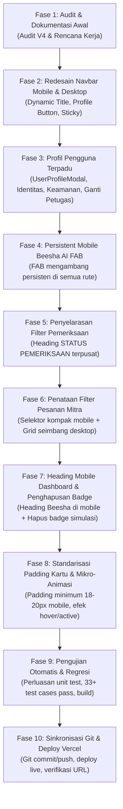

# RENCANA PELAKSANAAN TEKNIS V4.0 (IMPLEMENTATION PLAN)
## BEESHA — Sistem Informasi Operasional PT Putra Hatim Mandiri (PHM Group)
**Dokumen:** `docs/IMPLEMENTATION_PLAN_V4.md`  
**Target Rilis:** V4.0 Produksi  

---

## 1. Fase Pelaksanaan

---

## 2. Rincian Modifikasi Berkas

1. **`components/Navbar.tsx`**:
   - Tampilan Desktop: Pertahankan tombol Menu + Logo B + BEESHA + Subtitle + Nav items + Theme toggle + Profil button + Tanya Beesha.
   - Tampilan Mobile: Sederhanakan! Kiri: Hamburger icon (tanpa teks "Menu"). Tengah: Judul halaman aktif dinamis (`getScreenTitle`). Kanan: Theme icon + Profile icon.
2. **`components/UserProfileModal.tsx`**:
   - Komponen baru untuk Profil Pengguna Terpadu: Foto/Inisial, Identitas, NIK, Departemen, Shift, Info Kontak, Pengaturan Tema/Bahasa, Keamanan Akun (dengan batasan arsitektur jujur), Pergantian Petugas Operasional, dan Tombol Akhiri Sesi.
3. **`components/BeeshaFloatingFAB.tsx`**:
   - Komponen baru untuk tombol mengambang asisten AI di mobile, muncul di kanan bawah viewport di seluruh rute.
4. **`components/screens/VerificationScreen.tsx`**:
   - Tengahkan heading "STATUS PEMERIKSAAN" (`text-center uppercase tracking-wider`).
5. **`components/screens/OrderListScreen.tsx`**:
   - Buat selektor filter status kompak untuk mobile dengan modal/sheet terstruktur.
   - Buat grid filter seimbang untuk desktop.
   - Perbaiki padding kartu pesanan (`p-4.5 sm:p-5`) dan pastikan teks tidak menabrak batas kartu.
6. **`components/screens/DashboardScreen.tsx`**:
   - Heading responsif: Tampilkan `Beesha` pada mobile dan `Ringkasan Operasional` pada desktop.
   - Hapus badge "Data Simulasi" yang menonjol di sebelah heading.
   - Terapkan kelas `interactive-card` dan perbaiki padding kartu tugas & KPI.
7. **`components/screens/ProductionForm.tsx`, `DeliveryForm.tsx`, `NewOrderForm.tsx`, `AlertCenterScreen.tsx`, `ActivityHistoryScreen.tsx`**:
   - Pastikan padding kartu mobile konsisten (16–20px) dan teks nama mitra serta nomor dokumen tidak meluap.
8. **`app/page.tsx`**:
   - Pasang `BeeshaFloatingFAB`, integrasikan `UserProfileModal`, dan hubungkan state pembukaan profil dari navbar dan drawer.
9. **`utils/ui_interactions.test.ts`**:
   - Tambahkan skenario pengujian untuk V4: NAV-01 s/d NAV-05, PROF-01 s/d PROF-05, AI-01 s/d AI-05, DASH-01 s/d DASH-03, EXAM-01 s/d EXAM-04, ORDER-01 s/d ORDER-03, CARD-01 s/d CARD-05.
